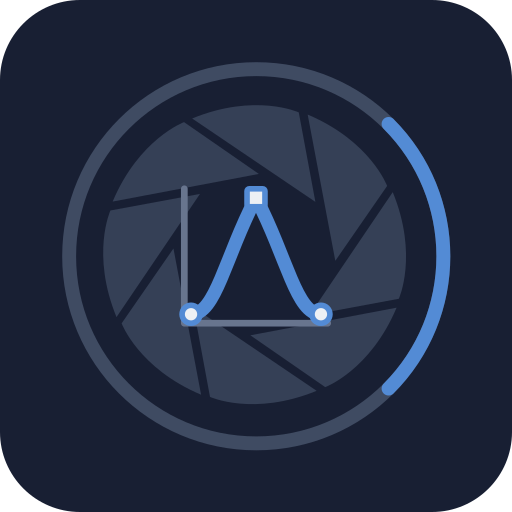

<p align="center">
  
</p>

# ShcKit

ShcKit is a pure Dart codec for Adobe Photoshop contour libraries (`.shc`), the curves that shape the falloff of shadows, glows, satin, and bevels. It has no Flutter or native-code dependency and builds on [`pscore`](https://pub.dev/packages/pscore).

## Supported data

- `8BFS` version 1 libraries with named contours in source order.
- Version 1 contour records with smooth points and version 2 records with per-point smooth or corner flags.
- UTF-16 names, input/output control points, and stored input-range bounds.
- Conversion to and from PsCore's `PsContour`, the descriptor that layer styles store in PSD and ASL files.
- Strict and tolerant decoding with compatibility warnings and configurable limits for file size, contours, points, and name lengths.
- Encoding from editable contour models and reusable `dart:convert` codecs and converters.

## Reading a file

```dart
import 'dart:io';
import 'dart:typed_data';

import 'package:shckit/shckit.dart';

final Uint8List bytes = await File('Contours.shc').readAsBytes();
final ShcFile library = ShcDecoder.decode(bytes);

for (final ShcContour contour in library.contours) {
  print('${contour.name}: ${contour.points.length} points');
}

for (final ShcWarning warning in library.warnings) {
  print(warning);
}
```

`ShcPoint.horizontal` is the input coordinate and `vertical` is the output coordinate, both on Photoshop's 0–255 grid. `continuous` distinguishes smooth points from corners; every point in a version 1 record is treated as smooth.

## Writing a library

```dart
final ShcFile library = ShcFile(
  contours: [
    ShcContour(
      name: 'Cone',
      points: const [
        ShcPoint(horizontal: 0, vertical: 0, continuous: false),
        ShcPoint(horizontal: 128, vertical: 255, continuous: false),
        ShcPoint(horizontal: 255, vertical: 0, continuous: false),
      ],
    ),
  ],
);

final Uint8List output = ShcEncoder.encode(library);
await File('Cone.shc').writeAsBytes(output);
```

New contours default to record version 2, so smooth/corner flags are written. Encoding rejects unsupported record versions, more than 65,535 points per contour, and coordinates outside 0–255 with `ShcWriteException`. It preserves the model's library version and input bounds, and does not repeat every strict-decoding check.

## Reusable `dart:convert` API

`ShcCodec` implements `Codec<ShcFile, List<int>>` and keeps the decoding policy in one reusable value:

```dart
const ShcCodec codec = ShcCodec(
  decodeOptions: ShcDecodeOptions(mode: ShcDecodeMode.strict),
);

final ShcFile library = codec.decode(bytes);
final Uint8List output = codec.encode(library);
```

The `List<int>` binary type allows composition with standard codecs such as `base64`; direct `encode` calls still return `Uint8List`. `ShcEncoder` and `ShcDecoder` are also reusable `Converter` implementations. Each conversion consumes or produces one complete in-memory SHC library.

## Strict, tolerant, and bounded decoding

Tolerant decoding is the default. An unexpected library version, contours with fewer than two points or coordinates above 255, and trailing bytes produce `ShcWarning` entries in `ShcFile.warnings`. Warnings include a byte offset and, when applicable, a contour index.

Strict mode turns the first compatibility issue into a `ShcFormatException`:

```dart
final ShcFile library = ShcDecoder.decode(
  bytes,
  options: const ShcDecodeOptions(mode: ShcDecodeMode.strict),
);
```

Invalid signatures, unsupported contour-record versions, truncated data, and exceeded resource limits always throw. Defaults allow up to 16 MiB per file, 100,000 contours, 256 points per contour, and 4,096 UTF-16 code units per name. Trailing bytes are reported but are not retained for re-encoding.

The bundled example prints contour names, points, and warnings:

```console
dart run example/main.dart Contours.shc
```

## Shared PSD and ASL contours

`ShcContour.fromContour` imports a PsCore contour, and `toContour` exposes an SHC record as a layer-style descriptor:

```dart
final PsContour fromStyle = PsContour.linear();
final ShcContour contour = ShcContour.fromContour(fromStyle);
final PsContour forStyle = contour.toContour();

final ShcFile exported = ShcFile(contours: [contour]);
await File('Linear.shc').writeAsBytes(ShcEncoder.encode(exported));
```

Importing descriptor coordinates rounds and clamps them to 0–255. Missing continuity flags become smooth points. Conversion carries the name and points; arbitrary descriptor fields and SHC input-range bounds are not part of that shared representation.

## Scope

ShcKit reads and writes contour libraries but does not evaluate curves or render layer effects. A host editor remains responsible for interpolation and applying the contour to its shadow, glow, satin, or bevel rendering.

Adobe's specification omits a 16-bit field before the point count. ShcKit follows the layout of real Photoshop libraries instead, and re-encodes them byte for byte; see [docs/SHC.md](docs/SHC.md).

See [docs/SHC.md](docs/SHC.md) for the binary layout, compatibility rules, encoding behavior, and descriptor conversion.

## References

- [Adobe Photoshop File Formats Specification](https://www.adobe.com/devnet-apps/photoshop/fileformatashtml/)

ShcKit is an independent implementation and is not affiliated with or endorsed by Adobe.

---

Built for **[Focale](https://focale-editor.app)**, an advanced local image editor. Discover what these packages make possible in a real creative workflow.
